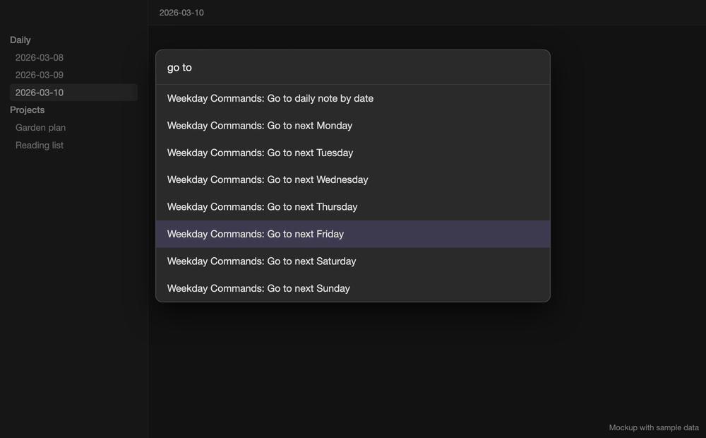

# Weekday Commands

Open the next occurrence of any weekday, or pick a date, from the command palette. If the daily note doesn't exist yet, it's created from your Daily Notes template.

*Mockup with sample data.*

## Commands

- **Go to daily note by date** opens a date picker. It accepts calendar dates, natural-language dates when Natural Language Dates is installed, and shortcuts to your three most recently edited daily notes. Press Enter or use **Open note** to open the date. If opening fails, the picker stays open so you can retry.
- **Go to next Sunday** through **Go to next Saturday** opens the next occurrence of that weekday.

Calendar dates are checked strictly, so invalid dates such as `2026-02-29` are rejected. Use `YYYY-MM-DD` to avoid ambiguity in numeric dates. Built-in relative phrases include `in 3 days`, `next week`, and `next December`.

Plain weekday entries such as `Friday` always mean the upcoming occurrence. Today, yesterday, and tomorrow are left out of the recent-note shortcuts.

## Settings

- **Integrate with Journal View** (off by default): sends every Weekday Commands navigation to Journal View, with its normal nearby animation or distant snap. Missing notes are still created.
- **Daily notes folder**: optionally overrides the Daily Notes plugin folder for Weekday Commands. Edits save when you leave the field. Date formats containing folders, such as `YYYY/MM/YYYY-MM-DD`, are supported.

## Requirements

Configure your preferred date format, folder, and template in Obsidian's built-in Daily Notes plugin or in Periodic Notes (with daily notes enabled). Natural Language Dates and Journal View are optional integrations.

## Privacy

Weekday Commands works locally in your vault, with no network services or telemetry. It has no recurring timers or vault watchers, and looks up recent notes only when the picker opens, using the configured folder. Pointer presses use a short CSS transition that respects reduced-motion preferences.

## Development

Run `npm ci` and `npm run check` for lint, type checking, the release build, and regression tests. Tests use the built plugin with an in-memory Obsidian API substitute and do not access a real vault.
